# Assessing Water Scarcity and Industrial Water Demand in the Philippines Through Data Mining: Implications for Future Industrial Development Under the Pax Silica Initiative

**Authors:** Casugbo, Marc Angelo D. · Milca, Jon Joshua Leonardo B. · Pongos, Auxi Nicole Z.

**Program:** BSCS - J3A

**Course:** Data Mining Capstone

**Submitted to:** Prof. Grachel Eliza C. Greta

**Date:** November 2026

---

## Repository Structure

| File / Folder | Description |
|---|---|
| `Original Datasets/` | Raw source files as downloaded from PSA and Our World in Data |
| `Data Understanding/Philippine_Water_Data_Understanding.ipynb` | Google Colab notebook for the initial inspection (structure, data types, missing values, duplicates, unusual values) |
| `Cleaned Datasets/` | Cleaned and integrated CSV files produced during preprocessing (see Section 3) |
| `EDA/EXPLORATORY_DATA_ANALYSIS.ipynb` | Google Colab notebook for exploratory data analysis |
| `Data Mining Models/Data Mining Techniques.ipynb` | Google Colab notebook for IQR anomaly detection, plus supporting trend and correlation analysis |
| `Images/` | Figures produced in Google Colab (listed below) |
| `Documentation/` | Full written capstone documentation (`CAPSTONE - Documentation.pdf`, 70 pages) |
| `Water_Resources_DataMining_Architecture.ows` | Orange Data Mining workflow (data inspection, visualization, correlation, and IQR anomaly detection) |

### Figures in `Images/`

| File | Content |
|---|---|
| `annual_total_water_supply.png` | Annual total water supply, 2010–2025 |
| `annual_total_water_use.png` | Annual total water use, 2010–2025 |
| `water_utilization_by_sector.png` | Annual water utilization by economic sector |
| `average_water_utilization_by_sector.png` | Average water utilization by economic sector |
| `industrial_water_withdrawal.png` | Philippine industrial water withdrawal, 1995–2023 |
| `industrial_wue.png` | Industrial water-use efficiency, 2016–2025 |
| `wue_by_sector.png` | Water-use efficiency by sector (Agriculture, Industry, Services) |
| `national_water_stress.png` | National water stress, 2016–2025 |
| `iqr_boxplot_industrial_withdrawal.png` | IQR box plot, industrial water withdrawal |
| `iqr_boxplot_industrial_wue.png` | IQR box plot, industrial water-use efficiency |
| `correlation_heatmap_2016_2023.png` | Pearson correlation heatmap, common period 2016–2023 |

---

## 1. Executive Summary & Problem Definition

### Background

Water supports households, agriculture, and industry. The Philippine Statistics Authority (PSA) reported a national water-stress level of 31.1% in 2025, up from 28.5% in 2024. This remains within the FAO's low-stress range (25–50%), but the increase shows why freshwater withdrawals need monitoring. The proposed Pax Silica development in New Clark City, Capas, Tarlac, which is intended to host semiconductor and advanced manufacturing facilities, is the application context for this study.

This study analyzes historical **national-level** indicators. It does **not** measure Pax Silica's actual water requirements, and it does not determine the water availability of the project site.

### Statement of the Problem

1. How have water supply and water utilization in the Philippines changed over the available years?
2. What trends can be observed in industrial water withdrawal and water-use efficiency?
3. How has the national level of water stress changed over the available period?
4. What patterns and relationships exist among water supply, water utilization, industrial water withdrawal, and water-stress indicators?
5. What data-driven recommendations can support sustainable water-resource management in view of future industrial development under the Pax Silica initiative?

### Objectives

1. Examine historical patterns in water supply and water utilization.
2. Analyze trends in industrial water withdrawal and water-use efficiency.
3. Assess changes in national water stress.
4. Apply **IQR-based anomaly detection** as the primary data mining technique, supported by trend and correlation analysis.
5. Evaluate and interpret results using appropriate measures and visualizations.
6. Develop data-driven recommendations for sustainable water management and industrial planning.

### Target Stakeholders

| Stakeholder | Relevance |
|---|---|
| Government agencies and policymakers | Supplementary evidence for water-resource planning |
| Industrial planners and developers | Historical context on industrial demand and efficiency |
| Environmental and water-resource researchers | Reference for Philippine water data and for data mining on environmental datasets |
| Students and future researchers | Worked example of data mining on public datasets |
| General public | Awareness of responsible water use |

---

## 2. Datasets & Data Acquisition

All data are secondary, publicly available sources. **No cloud data warehouse was used.** Preparation and analysis were done in **Google Colab (Python)** and **Orange Data Mining**.

| Dataset | Source | Coverage | Initial structure |
|---|---|---|---|
| Physical Supply Table for Water Resources | PSA OpenSTAT | 2010–2025 | 224 rows, 12 columns |
| Physical Use Table for Water Resources | PSA OpenSTAT | 2010–2025 | 208 rows, 12 columns |
| Industrial Water Withdrawal | Our World in Data (based on FAO AQUASTAT) | 1995–2023 for the Philippines | 6,792 rows, 4 columns (all countries) |
| Water Accounts of the Philippines | PSA | 2016–2025 | Excel workbook with multiple worksheets |

From the Water Accounts workbook, **Worksheet 3** (water-use efficiency) and **Worksheet 4** (level of water stress) were used, each giving 10 annual observations.

### Dataset limitations

- PSA data are national-level; they have no provincial or facility-level detail (e.g., none for New Clark City).
- The datasets differ in reporting periods, units, and definitions.
- PSA's industry category combines mining, manufacturing, and construction.
- The OWID series covers **self-supplied** industrial withdrawal only and may include estimated or imputed historical values.

---

## 3. Data Understanding & Preprocessing

### Data understanding (Python/pandas in Colab)

- No exact duplicate rows in any of the three CSV datasets. The Philippine OWID subset has 29 records and no repeated years.
- No negative values. Zero values appear in several PSA accounting columns and in the international OWID data (175 zero withdrawals); they were retained.
- OWID `Code` column: 391 missing values (about 5.76%). These do not affect the Philippine subset, which is filtered by `Code == "PHL"`.
- PSA tables contain blank cells that may mean "not applicable" rather than zero. The `Accumulation` column in the supply table is entirely empty, and all 16 `Households` observations in the use table are missing.
- Worksheets 3 and 4 of the Water Accounts workbook have multi-row headers, which required careful extraction.

### Preprocessing

| Step | What was done |
|---|---|
| Loading PSA CSVs | Semicolon separator, first two rows skipped, `.` and `..` treated as missing |
| Filtering | OWID data filtered to `PHL` (29 annual observations) |
| Missing values | Not imputed and not replaced with zero |
| Standardization | Column names lowercased with underscores; years converted to numeric |
| Unit handling | Converted only where the unit was confirmed; water stress kept as a decimal and multiplied by 100 for charts only |
| Integration | Outer join on `year`, sorted chronologically |
| Common period | **2016–2023** (8 annual observations shared by all five series) used for correlation analysis |

### Prepared datasets (`Cleaned Datasets/`)

`physical_water_supply_clean.csv`, `physical_water_use_clean.csv`, `philippine_industrial_withdrawal_clean.csv`, `water_use_efficiency_clean.csv`, `water_stress_clean.csv`, `supply_total_annual.csv`, `use_total_annual.csv`, `annual_master_dataset.csv`, `common_period_dataset.csv`, `cleaning_log.csv`, `transformation_log.csv`

### Features used

`year`, `total_supply`, `total_use`, `withdrawal_mcm` (industrial withdrawal), `water_used_industry`, `wue_industry`, `wue_overall`, `water_withdrawal_mcm`, `water_stress`.

> **No target variable was created.** The study is not a supervised prediction task, so no classification labels or models were used.

---

## 4. Exploratory Data Analysis

| Indicator | Period | Key result |
|---|---|---|
| Total water supply | 2010–2025 | Rose from 581,572 MCM (2010) to 739,393 MCM (2025) |
| Total water use | 2010–2025 | Same rise; **identical to the supply series every year** (flagged for validation) |
| Sectoral use | 2010–2025 | Electricity, Gas, Steam & Airconditioning Supply had the highest average (about 123,869 MCM), followed by Agriculture, Forestry and Fishing |
| Industrial water withdrawal | 1995–2023 | Generally increasing with fluctuations; low 2,296.00 MCM (1995), peak 16,188.80 MCM (2018), sharp drop in 2019 |
| Industrial water-use efficiency | 2016–2025 | Peak 586.11 PHP/m³ (2019), low 261.47 PHP/m³ (2025) |
| Sector WUE comparison | 2016–2025 | Services highest, Industry middle, Agriculture lowest |
| National water stress | 2016–2025 | Low 26.29% (2019), high 31.06% (2025) |

### Figures

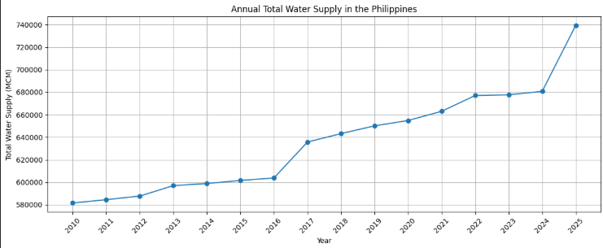

*Figure 1. Annual total water supply in the Philippines (2010–2025).*

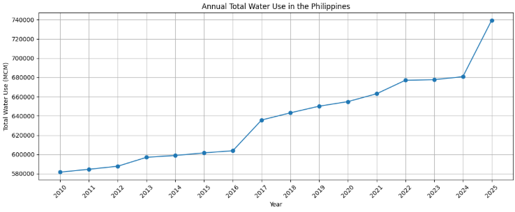

*Figure 2. Annual total water use in the Philippines (2010–2025).*

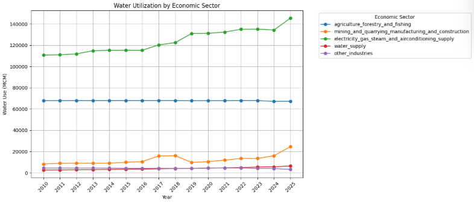

*Figure 3. Annual water utilization by economic sector (2010–2025).*

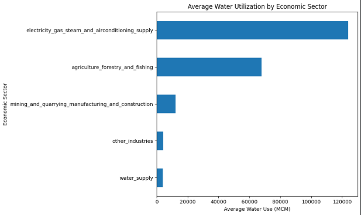

*Figure 4. Average water utilization by economic sector.*

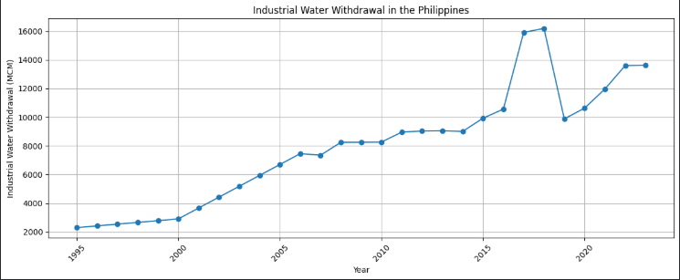

*Figure 5. Industrial water withdrawal in the Philippines (1995–2023).*

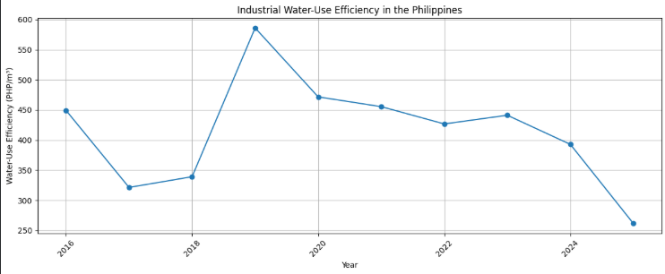

*Figure 6. Industrial water-use efficiency (2016–2025).*

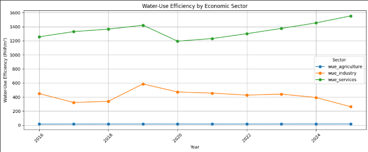

*Figure 7. Water-use efficiency by economic sector (2016–2025).*

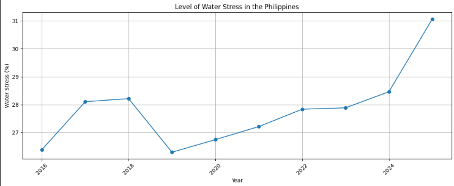

*Figure 8. National water stress in the Philippines (2016–2025).*

---

## 5. Data Mining Methodology

### Primary technique: IQR-based anomaly detection

Anomaly detection with the Interquartile Range (IQR) method was chosen because the data are numeric, annual, and **unlabelled**, so supervised classification was not appropriate. The IQR method also makes no assumption of normality.

```
IQR         = Q3 − Q1
Lower bound = Q1 − 1.5 × IQR
Upper bound = Q3 + 1.5 × IQR
```

Any value outside the bounds is flagged as a **potential anomaly**. A flag is a statistical observation, not proof of an error.

### Supporting techniques

| Method | Purpose |
|---|---|
| Trend analysis | Show how indicators changed over time |
| Pearson correlation | Show direction and strength of linear relationships (2016–2023, n = 8) |

### Tools

- **Google Colab (Python):** cleaning, transformation, integration, EDA, IQR analysis, and the main visualizations.
- **Orange Data Mining:** data inspection and visualization, correlation, and an IQR implementation in Python Script widgets (see Section 6).

---

## 6. Orange Data Mining Workflow

The workflow file is `Water_Resources_DataMining_Architecture.ows`. It has **44 nodes** and **37 links**. It contains no learner, Test and Score, or ROC widgets, because no predictive model was built.

**Inputs (7 File widgets):** Physical Water Use, Physical Water Supply, Annual Master Dataset, National Water Stress, Common Period Dataset, Industrial Water Withdrawal, Water-Use Efficiency.

**Inspection and visualization branches**

| Dataset | Widgets |
|---|---|
| Physical Water Use / Supply | File → Select Columns → Data Table, plus Column Statistics and Distributions |
| Annual Master Dataset | File → Select Columns → Data Table, Column Statistics, Distributions, Line Plot |
| National Water Stress | File → Select Columns → Data Table, Column Statistics, Distributions |
| Common Period Dataset | File → Select Columns → Data Table, Column Statistics, Distributions, Scatter Plot, **Correlations** |
| Industrial Water Withdrawal | File → Select Columns → Data Table, Column Statistics, Distributions, **Box Plot** |
| Water-Use Efficiency | File → Select Columns → Data Table, Column Statistics, Distributions, **Box Plot** |

**IQR anomaly detection branches**

- Industrial Water Withdrawal → **Python Script** (IQR on `withdrawal_mcm`) → Data Table "Industrial Water Withdrawal IQR Results"
- Water-Use Efficiency → **Python Script (1)** (IQR on `wue_industry`) → Data Table "WUE IQR Results"

Both scripts compute Q1, Q3, IQR, and the lower and upper bounds with NumPy percentiles, and flag values outside the bounds.

> **Note:** The File widgets store absolute paths from the author's machine (`C:/Users/casug/Downloads/Prepared_Datasets/...`). After cloning, re-point each File widget to the CSV files in `Cleaned Datasets/`.

---

## 7. Results

### 7.1 IQR anomaly detection

| Measure | Industrial Water Withdrawal | Industrial Water-Use Efficiency |
|---|---|---|
| Period | 1995–2023 | 2016–2025 |
| Observations | 29 | 10 |
| Q1 | 4,424.00 MCM | 366.008 PHP/m³ |
| Q3 | 9,931.00 MCM | 452.393 PHP/m³ |
| IQR | 5,507.00 MCM | 86.385 PHP/m³ |
| Lower boundary | −3,836.50 | 236.430 |
| Upper boundary | 18,191.50 | 581.971 |
| Potential anomalies | **0** (0%) | **1** (10%) |
| Flagged value | none (max 16,188.80 MCM in 2018) | **2019: 586.11 PHP/m³** (about 4.14 above the upper bound) |

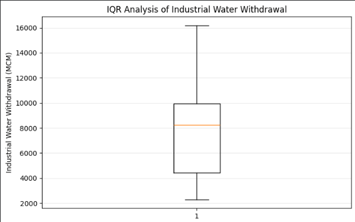

*Figure 9. IQR box plot of industrial water withdrawal.*

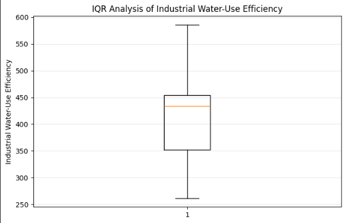

*Figure 10. IQR box plot of industrial water-use efficiency.*

**Interpretation:**

- No withdrawal value fell outside the bounds, even though the series fluctuated, notably around 2017–2019. Having no statistical outliers does not mean the series was stable.
- The 2019 efficiency value is only slightly above the upper bound. It is a potential anomaly, and the IQR method cannot explain its cause.

### 7.2 Correlation analysis (2016–2023, n = 8)

| Indicator pair | Pearson r | Relationship |
|---|---|---|
| Industrial withdrawal ↔ water stress | +0.961 | Strong positive |
| Industrial water used ↔ water stress | +0.960 | Strong positive |
| Industrial WUE ↔ water stress | −0.821 | Strong negative |
| Industrial WUE ↔ industrial withdrawal | −0.896 | Strong negative |
| Overall WUE ↔ water stress | +0.008 | Almost none |
| Total supply ↔ overall WUE | +0.800 | Strong positive |
| Total supply ↔ total use | +1.000 | Perfect (identical series) |

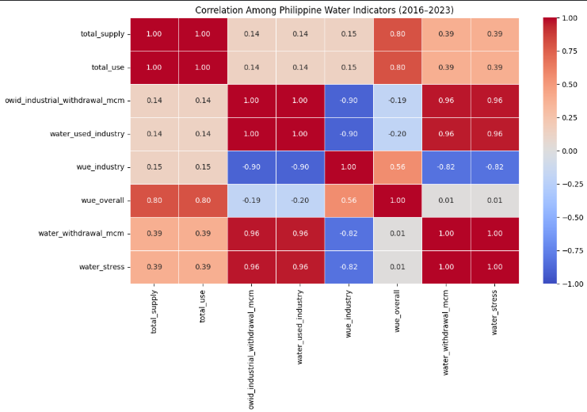

*Figure 11. Correlation heatmap of water-related indicators (2016–2023).*

**Cautions when reading these results:**

- Only 8 observations were used, so single years can strongly influence the coefficients.
- Supply and use are identical in the prepared data, so r = 1.000 is not independent evidence.
- Industrial withdrawal and industrial water used are nearly identical in several years.
- Water stress is computed from withdrawals and freshwater resources, so its correlation with withdrawal indicators is partly built into the indicator.
- These are associations, **not** causation.

---

## 8. Key Findings, Limitations & Recommendations

### Key findings

1. Prepared total supply and total use both rose from 581,572 MCM (2010) to 739,393 MCM (2025), but the two series are identical and need validation against the original PSA records.
2. Water use differs across sectors; Electricity, Gas, Steam & Airconditioning Supply is the highest-using sector with available values.
3. Industrial withdrawal generally increased from 1995 to 2023, peaking in 2018.
4. Industrial water-use efficiency fell after its 2019 peak, reaching its lowest value in 2025. This reflects economic output per m³, not necessarily higher physical consumption.
5. National water stress was lowest in 2019 (26.29%) and highest in 2025 (31.06%).
6. IQR detection flagged one potential anomaly (2019 industrial WUE) and none in industrial withdrawal.
7. Industrial withdrawal and water use moved strongly with water stress, and industrial WUE moved opposite to it, within the 8-year overlap.

### Recommendations (summary)

- **Water-resource management:** keep monitoring freshwater withdrawals and available renewable resources, and strengthen allocation planning across sectors.
- **Industrial efficiency:** adopt water-efficient processes, recycling and reuse, and regular water-use assessments.
- **Future industrial development (Pax Silica):** require site-specific water-resource assessments covering local availability, existing demand, and community and ecosystem effects. Sustainable systems such as rainwater harvesting, storage, treatment, and recycling should be considered.
- **Data management:** keep consistent, well-documented records, validate data before merging sources, and re-check the identical supply/use series.

### Limitations

| Limitation | Implication |
|---|---|
| National-level data only | Cannot describe conditions in a specific province or in New Clark City |
| Different periods, units, and definitions | Limits direct comparability across datasets |
| Combined mining/manufacturing/construction category | Industry-specific demand cannot be isolated |
| OWID covers self-supplied withdrawal only | Industrial use via public supply is excluded; some values may be estimated |
| Identical supply and use series | Possible extraction or accounting-definition issue; unresolved |
| Small samples (n = 8 for correlation, n = 10 for WUE IQR) | Results are exploratory |
| IQR flags statistical outliers only | A flag does not establish an error or a cause |
| Water stress is partly derived from withdrawal | Correlation with withdrawal is partly built-in |

---

## 9. Tools & Technologies Used

| Category | Tool / Library | Role |
|---|---|---|
| Programming & environment | Python 3, Google Colab | Cleaning, transformation, integration, EDA, IQR analysis, visualization |
| Python libraries | `pandas`, `numpy`, `matplotlib`, `seaborn` | Data handling, percentiles/IQR, charts, and correlation heatmap |
| Visual data mining tool | Orange Data Mining (`.ows`) | File, Select Columns, Data Table, Column Statistics, Distributions, Box Plot, Line Plot, Scatter Plot, Correlations, Python Script |
| Version control & hosting | GitHub | Code, datasets, workflow, and documentation |

---

## 10. Instructions for Reproducing the Analysis

1. **Clone the repository**
   ```bash
   git clone https://github.com/c-marcgelo/DMLABCapstone_Casugbo_Milca_Pongos.git
   cd DMLABCapstone_Casugbo_Milca_Pongos
   ```
2. **Obtain the source data.** The raw files are in `Original Datasets/`; the download links are in Section 11.
3. **Run the notebooks** in Google Colab (`Data Understanding/Philippine_Water_Data_Understanding.ipynb`, `EDA/EXPLORATORY_DATA_ANALYSIS.ipynb`, `Data Mining Models/Data Mining Techniques.ipynb`) to clean, transform, and merge the data and to produce the prepared CSVs and figures. Load PSA CSVs with `sep=";"`, `skiprows=2`, and `na_values=[".", ".."]`. Filter OWID to `Code == "PHL"`.
4. **Open the Orange workflow:** launch Orange, open `Water_Resources_DataMining_Architecture.ows`, and re-point each File widget to the corresponding CSV in `Cleaned Datasets/`.
5. **Inspect the IQR results** in the two Data Table widgets fed by the Python Script nodes.

---

## 11. References

Food and Agriculture Organization of the United Nations. (2018). *AQUASTAT glossary*. FAO. https://www.fao.org/nr/water/agwa/investment-tools/dti/tool/glossary

Our World in Data. (2026). *Industrial water withdrawal* [Data set]. Based on Food and Agriculture Organization of the United Nations, AQUASTAT. https://ourworldindata.org/grapher/industrial-water-withdrawal

Philippine Information Agency. (2026, August 10). *BCDA clarifies misconceptions on Pax Silica project in New Clark City*. https://pia.gov.ph/news/bcda-clarifies-misconceptions-on-pax-silica-project-in-new-clark-city/

Philippine Statistics Authority. (2026a). *Physical supply table for water resources*. OpenSTAT. https://openstat.psa.gov.ph/PXWeb/pxweb/en/DB/DB__3A/0013A5DWPS0.px/

Philippine Statistics Authority. (2026b). *Physical use table for water resources*. OpenSTAT. https://openstat.psa.gov.ph/PXWeb/pxweb/en/DB/DB__3A/0023A5DWPU0.px/

Philippine Statistics Authority. (2026c, September 3). *Country's water use efficiency declined to PhP 221.48 per cubic meter in 2025*. https://psa.gov.ph/statistics/environmental-accounts/node/1684084131
